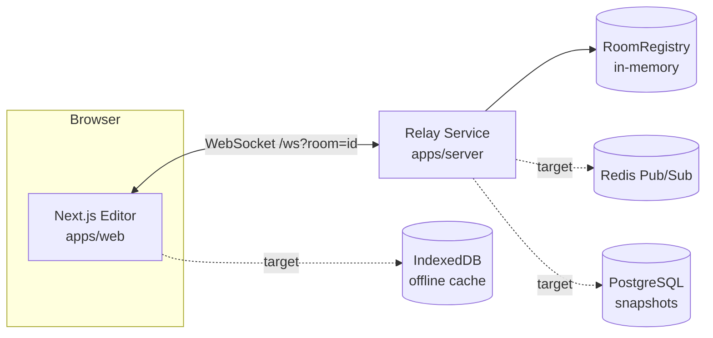

# Collaborative Editor

> Real-time collaborative editing scaffold: a TypeScript WebSocket relay service plus a Next.js client that edits a shared document live.

[](./.github/workflows/ci.yml)
[](./LICENSE)
[](https://nodejs.org)
[](https://nextjs.org)

## Overview

This repository is a **functional scaffold** for a real-time collaborative text editor.
It ships a runnable Node.js + TypeScript relay service (Express + `ws`) that keeps an
in-memory document per room and broadcasts updates to connected clients, along with a
minimal Next.js (App Router) client whose text area is wired to the WebSocket endpoint.

It is a scaffold, not a product: conflict resolution uses last-write-wins over a
transport-agnostic room model, with a clear seam to plug in a CRDT (Yjs) and Redis
Pub/Sub for multi-instance fan-out.

## Problem & Solution

**Problem:** Teams need to edit the same document at the same time without stepping on
each other. Naive "save and refresh" flows lose work and require manual merging.

**Solution:** Keep a canonical document per room on the server, accept incremental updates
over a persistent WebSocket, and broadcast every change to the other participants in the
room. The room logic is pure and unit-tested, so the transport can be swapped without
touching the collaboration semantics.

## Tech Stack

| Layer            | Technology                                   |
| ---------------- | -------------------------------------------- |
| Runtime          | Node.js 20+, TypeScript 5                     |
| Realtime server  | Express + `ws` (WebSocket)                    |
| Frontend         | Next.js 16 (App Router), React 19             |
| Collaboration    | Last-write-wins relay (Yjs/CRDT target)       |
| Storage (target) | PostgreSQL, Redis Pub/Sub                     |
| Client cache     | IndexedDB (target)                            |
| Monorepo         | npm workspaces                                |
| Testing          | Vitest (+ integration WebSocket test)         |
| Containers       | Docker, Docker Compose                        |

## Architecture



Message flow: on connect the client receives a `sync` snapshot, then sends
`{ "type": "update", "content": "..." }` messages. The server bumps the room revision and
broadcasts `{ "type": "update", ... }` to every other member.

## Project Structure

```
web-02-collaborative-editor/
├── apps/
│   ├── server/              # Express + ws relay
│   │   ├── src/
│   │   │   ├── rooms.ts     # pure room/relay logic
│   │   │   └── index.ts     # HTTP + WebSocket entrypoint
│   │   └── tests/
│   └── web/                 # Next.js App Router client
│       └── app/
├── docs/
│   ├── architecture.md
│   └── adr/0001-initial-architecture.md
├── .github/workflows/ci.yml
├── docker-compose.yml
└── Dockerfile
```

## Getting Started

### Local

```bash
npm install
npm run dev -w @collab/server    # http://localhost:8080 (ws://localhost:8080/ws)
npm run dev -w @collab/web       # http://localhost:3000
```

Verify the relay:

```bash
curl http://localhost:8080/health
# {"status":"ok","service":"collab-relay"}
```

### Docker

```bash
cp .env.example .env
docker compose up --build
curl http://localhost:8080/health
```

## Configuration

Secrets come only from environment variables.

| Variable             | Description                          | Default                    | Required |
| -------------------- | ------------------------------------ | -------------------------- | -------- |
| `PORT`               | HTTP/WebSocket port                  | `8080`                     | no       |
| `NODE_ENV`           | Runtime environment                  | `development`              | no       |
| `CORS_ORIGIN`        | Allowed origin for the web client    | `http://localhost:3000`    | no       |
| `MAX_ROOM_MEMBERS`   | Soft cap on clients per room         | `50`                       | no       |
| `REDIS_URL`          | Redis for multi-instance fan-out     | –                          | no       |
| `DATABASE_URL`       | PostgreSQL for durable snapshots     | –                          | no       |

## API / Usage

| Method | Path          | Description                          |
| ------ | ------------- | ------------------------------------ |
| GET    | `/`           | Service metadata                     |
| GET    | `/health`     | Liveness probe                       |
| GET    | `/api/rooms`  | Active rooms with member counts      |
| WS     | `/ws?room=id` | Real-time document relay             |

WebSocket messages:

```jsonc
// server -> client (on join)
{ "type": "sync", "roomId": "demo", "revision": 0, "content": "" }
// client -> server
{ "type": "update", "content": "hello world" }
// server -> other clients
{ "type": "update", "roomId": "demo", "revision": 1, "content": "hello world", "origin": "<client-id>" }
```

## Testing

```bash
npm test                          # all workspaces
npm test -w @collab/server        # room logic + WebSocket integration
```

Unit tests exercise the pure `DocumentRoom`/`RoomRegistry` logic (snapshot on join,
broadcast excluding origin, revision increments, member cleanup). Integration tests spin
up the real HTTP + WebSocket server on an ephemeral port and relay a document update
between two clients.

## Quality Standards

- **Testing:** Vitest unit tests for room logic plus an end-to-end WebSocket integration
  test; CI runs them on every push and PR.
- **CI/CD:** GitHub Actions installs, type-checks, tests and builds both workspaces.
- **Security:** no secrets in code; room ids and message payloads validated before use;
  message size capped; containers run as a non-root user.
- **Performance:** broadcast is O(members) per update and never echoes to the sender;
  the stateless relay can be horizontally scaled with Redis Pub/Sub.
- **UX:** the client shows connection status and sends updates on change.
- **Documentation:** README, `docs/architecture.md` and an ADR capture the design.

## Roadmap

- [ ] Replace last-write-wins with Yjs CRDT updates.
- [ ] Redis Pub/Sub fan-out across relay instances.
- [ ] PostgreSQL snapshot persistence and history.
- [ ] Presence (cursors, avatars) and awareness protocol.
- [ ] IndexedDB offline editing and reconnect with delta sync.
- [ ] WebRTC peer transport as a fallback for low-latency links.
