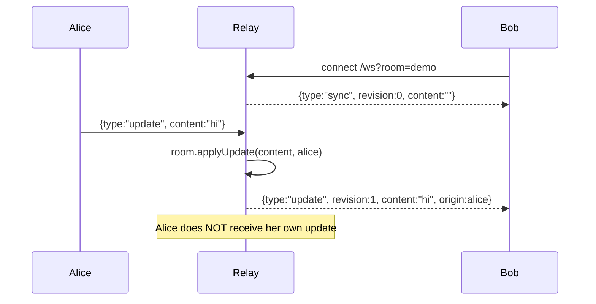

# Architecture

## Context

The collaborative editor keeps a shared document in sync across many clients in real time.
This document describes the scaffold's design and the seams left for a production build.

## Components

| Component     | Location                | Responsibility                                 |
| ------------- | ----------------------- | ---------------------------------------------- |
| Relay service | `apps/server`           | HTTP surface + WebSocket fan-out               |
| Room logic    | `apps/server/src/rooms.ts` | Pure document + member state (unit tested)  |
| Web client    | `apps/web`              | Next.js editor wired to the WebSocket endpoint |

## Room model

A `DocumentRoom` owns:

- `content` — the canonical document text.
- `revision` — a monotonically increasing counter.
- `members` — connected clients that expose a `send(payload)` function.

Keeping `RoomMember` as an interface (not a `ws` socket) means the collaboration logic is
trivially unit testable and the transport is replaceable.

## Conflict strategy

The scaffold uses **last-write-wins**: the most recent update replaces the document. This is
deliberately simple and deterministic. The roadmap replaces the `content` string with a Yjs
CRDT so concurrent edits merge instead of overwriting. Because `DocumentRoom` is isolated
from the transport, that swap is localised.

## Scaling (target)

The relay is stateless apart from the in-memory registry. To run multiple instances:

1. Publish each update to a Redis Pub/Sub channel keyed by room.
2. Each instance subscribes and fans out to its own sockets.
3. Persist snapshots to PostgreSQL for durability and history.

## Security

- Room ids are validated against `^[A-Za-z0-9_-]{1,64}$`.
- Message frames are JSON-parsed with a size cap (`maxPayload`) and a content length cap.
- Unknown message types are rejected with an `error` frame instead of crashing a connection.
- Containers run as a non-root user; secrets are read from environment variables only.
